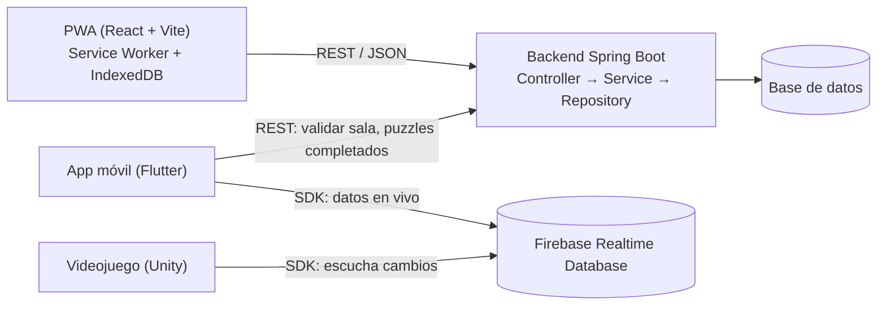
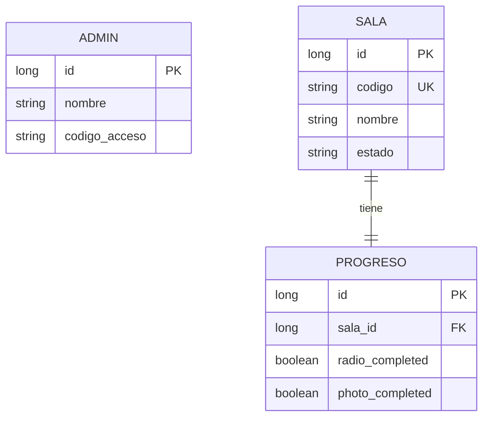
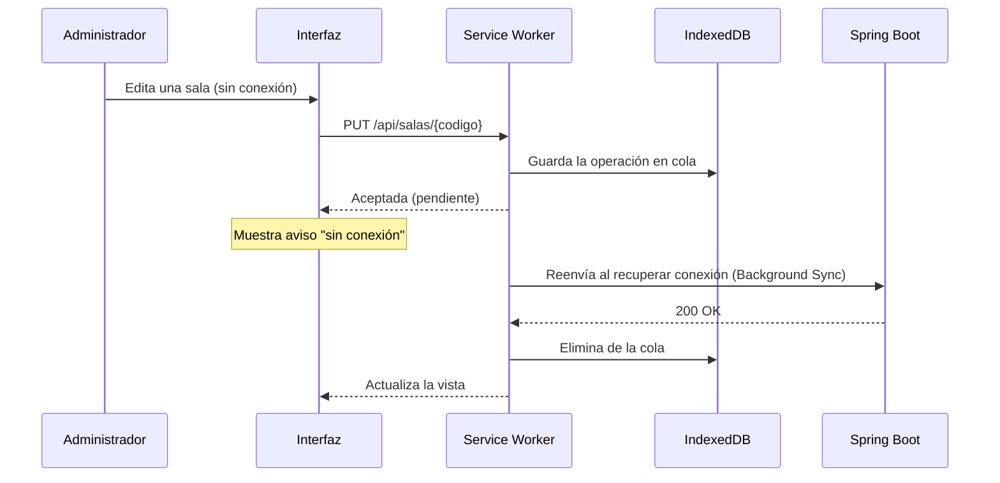
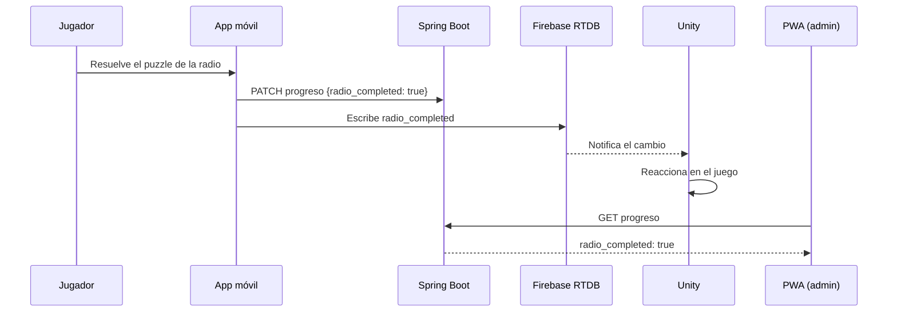
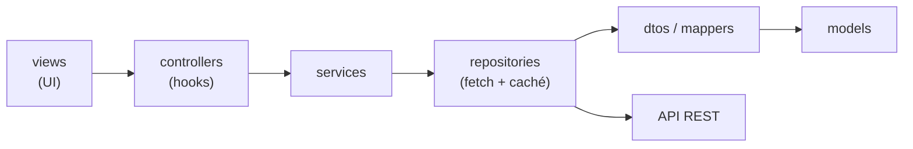

# Vestigia PWA — Panel de administración

> Preproyecto de **Aplicaciones Web Progresivas** · Grupo IDGS101N · Universidad Tecnológica de Chihuahua
> Parte del proyecto integrador **Vestigia**, una aventura de misterio para PC con una aplicación móvil complementaria.

**Integrantes:** Ailton Márquez, Raúl Cano, Aldo Alberto, María Jose, Oliver Manríquez, Iram Álvarez · **Repositorio del backend:** https://github.com/Oliveriswackk/Vestigia/tree/main/backend/vestigia · **Monorepo del proyecto:** https://github.com/Oliveriswackk/Vestigia

---

## 1. Contexto

Vestigia es un videojuego en Unity que se complementa con un teléfono: el jugador resuelve puzzles en el celular y el resultado se refleja en el juego. Cada partida se identifica con una **sala** y un **código de sala**.

La PWA es el **panel de administración** del proyecto. Permite al equipo:

- Crear, consultar, modificar y eliminar salas (CRUD).
- Consultar el progreso de cada sala (puzzles completados).
- Seguir usándose con mala conexión o sin ella (modo offline).

## 2. Propuesta de arquitectura

La PWA solo se comunica con el backend en Spring Boot mediante endpoints REST. Para las interacciones en vivo (posición del dedo, mirador), el celular y Unity usan Firebase Realtime Database; la PWA no depende de él.



**Reparto de datos**

| Tipo de dato | Dónde vive | Ejemplos |
|---|---|---|
| Duradero (CRUD) | Spring Boot + base de datos | Salas, administradores, `radio_completed`, `photo_completed` |
| En vivo, efímero | Firebase Realtime Database | Posición del dedo, posición del mirador, `photo_quantity` |

## 3. Consumo de API

El backend sigue la estructura vista en clase: `controller`, `dto`, `model`, `repository` y `service`. La PWA replica esa separación en el cliente (sección 7). Los JSON usan `snake_case`.

| Método | Endpoint | Descripción |
|---|---|---|
| `POST` | `/api/auth/login` | Inicio de sesión con código de acceso de administrador |
| `GET` | `/api/salas` | Lista de salas |
| `GET` | `/api/salas/{codigo}` | Detalle de una sala |
| `POST` | `/api/salas` | Crear sala |
| `PUT` | `/api/salas/{codigo}` | Modificar sala |
| `DELETE` | `/api/salas/{codigo}` | Eliminar sala |
| `GET` | `/api/salas/{codigo}/progreso` | Progreso de la sala |
| `PATCH` | `/api/salas/{codigo}/progreso` | Actualizar solo los campos enviados |

Ejemplo de respuesta de `GET /api/salas/{codigo}/progreso`:

```json
{
  "radio_completed": true,
  "photo_completed": false
}
```

### Modelo de datos



## 4. Estrategia PWA

### Manifiesto

`public/manifest.webmanifest` define el nombre, los íconos (192 y 512 px, incluyendo versión *maskable*), `display: standalone`, y `theme_color` y `background_color` en `#000F20` para que la pantalla de carga coincida con la interfaz.

### Service Worker

Se genera con `vite-plugin-pwa` (Workbox).

| Recurso | Estrategia | Motivo |
|---|---|---|
| Shell de la app (HTML, JS, CSS, fuentes, íconos) | *Precache* | La app abre sin conexión |
| `GET /api/**` | *Stale-while-revalidate* | Muestra lo último conocido y actualiza en segundo plano |
| `POST` / `PUT` / `PATCH` | Cola en IndexedDB + *Background Sync* | No se pierden cambios hechos sin conexión |
| `DELETE` | Solo con conexión | Evita ejecutar un borrado que ya no tiene sentido al reconectar |

### Funcionamiento sin conexión y en segundo plano

- Un aviso visible indica el estado **sin conexión** y qué acciones están en cola.
- Al recuperar la conexión se reenvían las operaciones pendientes. Si el navegador no soporta *Background Sync*, se usa el evento `online` como respaldo.
- Mientras la app está abierta, la lista de salas y el progreso se refrescan periódicamente en segundo plano.
- Se ofrece instalar la app desde el navegador (`beforeinstallprompt`).



### Cómo llega un puzzle al juego



## 5. Interfaz y experiencia de usuario (UI/UX)
### Propuesta visual (video)

🎥 [Ver el video de la propuesta visual] https://drive.google.com/file/d/16lJ8L9jZm3J_LAivoM2BQK-TRPIxMQ5U/view?usp=sharing

El video muestra el recorrido por las tres pantallas (inicio de sesión, lista de salas y detalle de sala), la paleta de colores y el comportamiento sin conexión.


### Posibles pantallas

1. **Inicio de sesión:** campo de código de acceso (solo para nosotros que seremos los administradores).
2. **Lista de salas:** tarjetas con código, nombre y estado; acciones de crear, editar y eliminar.
3. **Detalle de sala:** progreso de los puzzles y botón para editar.

Componentes transversales: aviso de conexión, confirmación antes de eliminar, estados de carga y de error.

### Diseño adaptable

Se diseña primero para móvil y se amplía con *media queries*. Las listas pasan de una columna a una cuadrícula en pantallas grandes. Los botones tienen al menos 44 px de alto para uso táctil.

### Identidad visual

Sigue la guía de estilo de Vestigia, con tema oscuro por defecto.

| Uso | Color |
|---|---|
| Fondo base (Azul marino) | `#000F20` |
| Acento y acciones (Amarillo) | `#FFCC00` |
| Neutros | Papel `#F6F1E7` · Marfil `#FFFCF4` · Piedra `#D7D1C6` · Niebla `#9EABB6` · Pizarra `#263A49` · Carbón `#17212B` |

- **Mona Sans:** interfaz, instrucciones y etiquetas.
- **Literata:** textos narrativos, si los hay.
- **Playball:** solo en el logotipo (se usa como SVG).

Las fuentes se alojan en la propia app (WOFF2) para que se vean igual sin conexión. El amarillo no se usa como texto sobre fondos claros por su bajo contraste.

## 6. Tecnologías

React · Vite · JavaScript · CSS modular · `vite-plugin-pwa` (Workbox) · IndexedDB · Spring Boot (backend) · Git y GitHub

> **Pendiente:** el informe de planeación del proyecto indica TypeScript; este preproyecto usa JavaScript según el enunciado de la asignatura. Confirmar la decisión final con el profesor.

## 7. Estructura del proyecto

La PWA replica en el cliente la separación del backend. `views` contiene solo interfaz; la lógica se orquesta en `controllers` (hooks), `services` y `repositories`.

```
vestigia-pwa/
├── public/
│   ├── manifest.webmanifest
│   ├── icons/
│   └── fonts/
├── src/
│   ├── views/
│   │   ├── pages/        # LoginPage, SalasPage, SalaDetallePage
│   │   └── components/   # SalaCard, OfflineBanner
│   ├── controllers/      # Hooks: useSalaController, useProgresoController
│   ├── services/         # Lógica de negocio: SalaService, ProgresoService
│   ├── repositories/     # Acceso a datos: fetch + caché offline
│   ├── dtos/             # Forma de la API (snake_case) y mappers
│   ├── models/           # Objetos de dominio de la UI (camelCase)
│   ├── config/           # apiConfig (URL base, tiempos de espera)
│   ├── pwa/              # registerSW, useOnlineStatus, cola de sincronización
│   ├── styles/           # CSS modular y variables de la guía de estilo
│   ├── App.jsx
│   └── main.jsx
├── .env.example          # VITE_API_URL
├── vite.config.js        # Configuración del plugin PWA
└── README.md
```



## 8. Ejecución

```bash
npm install
cp .env.example .env     # configurar VITE_API_URL
npm run dev              # desarrollo
npm run build && npm run preview   # prueba del Service Worker y la instalación
```

> El Service Worker solo se activa en el build de producción (`preview`) o en `localhost`.

## 9. Flujo de trabajo en Git

### Ramas

`main` es la rama estable y está protegida: no se hace push directo y los cambios entran por pull request con revisión.

Formato: `tipo/numero-issue-descripcion-corta`, en minúsculas y con guiones.

| Prefijo | Uso | Ejemplo |
|---|---|---|
| `new/` | Funcionalidad o archivo nuevo | `new/12-lista-salas` |
| `refactor/` | Cambiar la estructura de algo existente | `refactor/20-separar-dtos-models` |
| `fix/` | Corregir un error | `fix/25-cache-offline` |

### Commits

| Prefijo | Uso |
|---|---|
| `New:` | Algo nuevo que no existía |
| `Refactor:` | Cambio de estructura de algo existente |
| `Fix:` | Corrección de un bug o error |
| `Merge:` | Integración de ramas |

Ejemplos: `New: agrega listado de salas con caché offline` · `Fix: corrige la cola de sincronización` · `Merge: integra new/12-lista-salas en main`

### Pull requests

El título lleva el prefijo del tipo de cambio. La descripción indica qué hace, cómo se comprobó y a qué issue se relaciona.

## 10. Próximos pasos

- [ ] Confirmar la lista de endpoints con el backend.
- [ ] Prototipar las pantallas en Figma con la guía de estilo.
- [ ] Implementar el Service Worker y la cola de sincronización.
- [ ] Definir las reglas de seguridad y el manejo de sesión de administrador.
- [ ] Agregar pruebas y un flujo de GitHub Actions (instalar, analizar, probar y compilar).