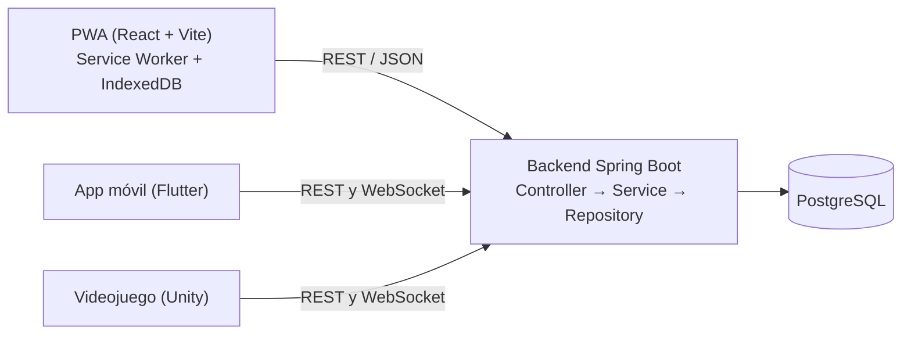
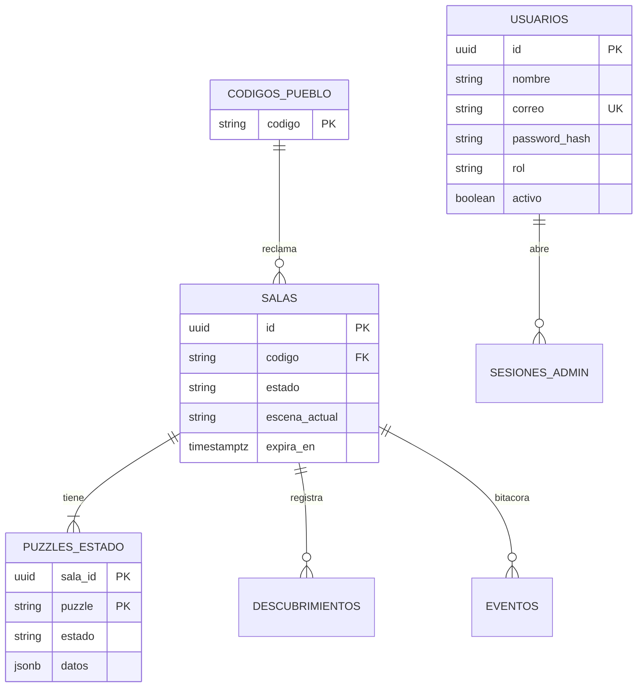
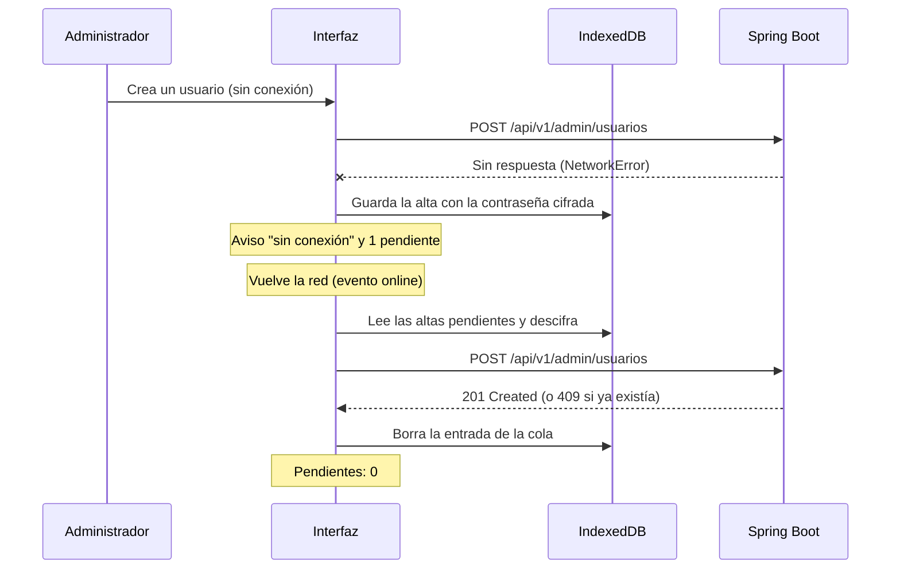
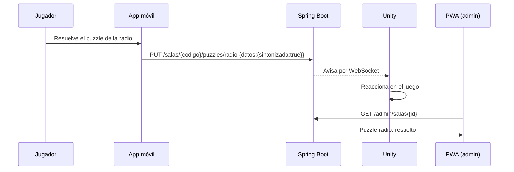
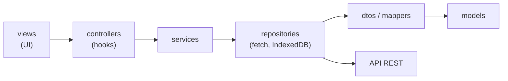

# Vestigia PWA

> Preproyecto de **Aplicaciones Web Progresivas** · Grupo IDGS101N · Universidad Tecnológica de Chihuahua
> Parte del proyecto integrador **Vestigia**, una aventura de misterio para PC con una aplicación móvil complementaria.

**Integrantes:** Ailton Márquez, Raúl Cano, Aldo Alberto, María Jose, Oliver Manríquez, Iram Álvarez · **Repositorio del backend:** https://github.com/TheCodeOfGod/vestigia-backend · **Monorepo del proyecto:** https://github.com/Oliveriswackk/Vestigia

---

## 1. Contexto

Vestigia es un videojuego en Unity que se complementa con un teléfono: el jugador resuelve puzzles en el celular y el resultado se refleja en el juego. Cada partida se identifica con una **sala**, que reclama un **pueblo** del catálogo de 101 (el pueblo es el código de la sala).

La PWA tiene dos partes:

- **Sitio público:** portada con escena 3D (`/`), libreta con capturas reales de la app móvil (`/libreta`), presentación del elevator pitch (`/pitch`) y catálogo de pueblos libres y ocupados (`/salas`).
- **Panel de administración** (`/dashboard`, con sesión): consultar las partidas y su detalle, y dar de alta administradores. Sigue funcionando con mala conexión: el catálogo se cachea y el alta de administradores se guarda en una cola cifrada hasta que vuelve la red.

La PWA **no** crea, edita ni cierra salas: eso lo hacen el juego y la app móvil.

## 2. Propuesta de arquitectura

La PWA solo se comunica con el backend en Spring Boot mediante endpoints REST. Para las interacciones en vivo (posición del dedo, mirador) el celular y Unity usan WebSocket y Firebase; la PWA no depende de ellos.



**Reparto de datos**

| Tipo de dato | Dónde vive | Ejemplos |
|---|---|---|
| Duradero | Spring Boot + PostgreSQL | Pueblos, salas, estado de puzzles, descubrimientos, bitácora de eventos, usuarios y sesiones de administración |
| En el navegador | IndexedDB, `sessionStorage` y Cache Storage | Cola de altas pendientes y su clave de cifrado, token de sesión, copia del catálogo de pueblos |

## 3. Consumo de API

El backend (repo `vestigia-backend`) sigue la estructura `controller`, `dto`, `model`, `repository` y `service`; la PWA replica esa separación en el cliente (sección 7). Los JSON usan `snake_case` y los errores un formato uniforme (`timestamp`, `status`, `codigo`, `message`, `details`). Todas las rutas cuelgan de `/api/v1`. Contrato completo: `docs/api.md` y `docs/integracion-pwa.md` del backend.

Endpoints que usa la PWA:

| Método | Endpoint | Acceso | Descripción |
|---|---|---|---|
| `GET` | `/pueblos` | Público | Catálogo de 101 pueblos; los ocupados traen `libre: false` |
| `POST` | `/auth/login` | Público | Inicio de sesión con correo y contraseña (límite de 5 fallos por correo en 15 min → `429`) |
| `POST` | `/auth/logout` | Sesión admin | Cierra la sesión |
| `GET` | `/auth/yo` | Sesión admin | Usuario dueño de la sesión |
| `GET` | `/admin/salas` | Sesión admin | Partidas vivas y terminadas, con filtro por estado |
| `GET` | `/admin/salas/{id}` | Sesión admin | Detalle de una sala y su bitácora |
| `DELETE` | `/admin/salas/{id}` | Sesión admin | Libera la sala: pasa a `finalizada` y libera el pueblo (`204`, también si ya había terminado; `404` si no existe) |
| `GET` | `/admin/usuarios` | Sesión admin | Lista de usuarios |
| `POST` | `/admin/usuarios` | Sesión admin | Alta de administrador (`201`; `400` datos inválidos; `409 correo_duplicado`) |

El backend también tiene `PUT` y `DELETE` de usuarios, que la PWA todavía no usa. El juego y la app usan el resto de rutas (`/salas/...`) con un token de sala distinto al de la sesión de administración.

### Modelo de datos (backend)



Los puzzles son `radio`, `photo`, `lookout` y `observatory`. Las migraciones (Flyway V1 a V4) crean el esquema y cargan los 101 pueblos al arrancar el backend.

## 4. Estrategia PWA

### Manifiesto

`public/manifest.webmanifest` define el nombre, los íconos (192 y 512 px, incluyendo versión *maskable*), `display: standalone`, y `theme_color` y `background_color` en `#000F20` para que la pantalla de carga coincida con la interfaz.

### Service Worker

Se genera con `vite-plugin-pwa` (Workbox, `registerType: autoUpdate`) y está configurado en `vite.config.ts`.

| Recurso | Estrategia | Motivo |
|---|---|---|
| Shell de la app (HTML, JS, CSS, fuentes, imágenes) | *Precache*; cualquier ruta cae en el shell | La app y `/salas` abren sin conexión |
| `GET /api/v1/pueblos` | *NetworkFirst* (espera 5 s a la red; caché `api-pueblos`, solo respuestas `200`) | `libre` cambia en cuanto un juego abre o cierra una sala, así que gana la red; la copia solo sirve sin respuesta |
| Resto de `/api/**` | Sin caché | Datos del panel y de sesión: no se muestran copias viejas |
| `public/capturas-app/` (~49 MB) | Fuera del precache | Se descargan al usarse |

### Funcionamiento sin conexión

- Un aviso (`ConnectionStatus`) indica el estado **sin conexión** y cuántas operaciones esperan sincronizarse.
- Cada petición tiene un límite de 10 s y se cancela al salir de la página.
- **Alta de administradores sin conexión:** si `POST /admin/usuarios` falla por falta de red, se guarda en la cola de IndexedDB (`vestigia` › `usuariosPendientes`) con la contraseña cifrada con AES-GCM (WebCrypto, clave no extraíble). Protege contra leer el volcado de la base, no contra un XSS. Se reenvía en orden al volver la red (evento `online`), al abrir el panel y tras iniciar sesión.
- Al reenviar: `409 correo_duplicado` cuenta como ya sincronizado y se borra; `400` marca la entrada con error y no se reintenta; `401` o falta de red detienen el envío y la entrada sigue pendiente. Cerrar sesión borra la cola y la clave.
- Solo se encolan las altas de usuario. Cualquier otra escritura y cerrar salas exigen conexión. No se usa Background Sync: el reenvío ocurre con la app abierta.



### Cómo llega un puzzle al juego



## 5. Interfaz y experiencia de usuario (UI/UX)
### Propuesta visual (video)

🎥 [Ver el video de la propuesta visual] https://drive.google.com/file/d/16lJ8L9jZm3J_LAivoM2BQK-TRPIxMQ5U/view?usp=sharing

El video muestra el recorrido por las tres pantallas (inicio de sesión, lista de salas y detalle de sala), la paleta de colores y el comportamiento sin conexión.


### Pantallas

| Ruta | Pantalla | Sesión |
|---|---|---|
| `/` | Portada con escena 3D, historia con scroll y sonido ambiente | No |
| `/libreta` | Libreta de campo con capturas reales de la app móvil | No |
| `/pitch` | Presentación del elevator pitch | No |
| `/salas` | Catálogo de pueblos, con filtro libres / en partida | No |
| `/login` | Inicio de sesión de administrador | No |
| `/dashboard` | Inicio con accesos a cada pantalla | Sí |
| `/dashboard/salas` y `/dashboard/salas/{id}` | Partidas (paginadas, filtro por estado) y su detalle | Sí |
| `/dashboard/usuarios` | Lista y alta de administradores, y altas en cola | Sí |

Componentes transversales: aviso de conexión, estados de carga y de error, y botón para mostrar u ocultar contraseñas.

### Diseño adaptable

Se diseña primero para móvil y se amplía con *media queries*. Las listas pasan de una columna a una cuadrícula en pantallas grandes. Los botones tienen al menos 44 px de alto para uso táctil.

### Identidad visual

Sigue la guía de estilo de Vestigia, con tema oscuro por defecto.

| Uso | Color |
|---|---|
| Fondo base (Azul marino) | `#000F20` |
| Acento y acciones (Amarillo) | `#FFCC00` |
| Neutros | Papel `#F6F1E7` · Marfil `#FFFCF4` · Piedra `#D7D1C6` · Niebla `#9EABB6` · Pizarra `#263A49` · Carbón `#17212B` |

- **Mona Sans:** interfaz, instrucciones y etiquetas.
- **Literata:** textos narrativos, si los hay.
- **Playball:** solo en el logotipo (se usa como SVG).

Las fuentes se alojan en la propia app (WOFF2) para que se vean igual sin conexión. El amarillo no se usa como texto sobre fondos claros por su bajo contraste.

## 6. Tecnologías

React 19 · Vite · TypeScript · React Router · CSS Modules · Three.js (React Three Fiber) · Web Audio · `vite-plugin-pwa` (Workbox) · IndexedDB y WebCrypto · Docker y Nginx · Lighthouse CI · oxlint, Prettier, Husky · Spring Boot y PostgreSQL (backend) · Git y GitHub

## 7. Estructura del proyecto

La PWA replica en el cliente la separación del backend. `views` contiene solo interfaz; la lógica se orquesta en `controllers` (hooks), `services` y `repositories`.

```
vestigia-pwa/
├── public/               # manifest, íconos, fuentes, capturas-app (pitch y libreta)
├── src/
│   ├── views/
│   │   ├── pages/        # Landing, Libreta, Pitch, Pueblos, Login, PanelLayout, Dashboard, Salas, Usuarios
│   │   ├── components/   # Button, ConnectionStatus, FormField, UsuariosPendientes…
│   │   ├── three/        # Escena 3D de la portada
│   │   ├── story/        # Reloj de la historia: scroll con inercia → progreso 0–1
│   │   ├── libreta/      # Maqueta de teléfono y capturas
│   │   ├── pitch/        # Diapositivas del elevator pitch
│   │   └── audio/        # Sonido de tormenta sintetizado (sin archivos)
│   ├── controllers/      # Hooks que orquestan: useUsuariosController, useSesionController…
│   ├── hooks/            # Hooks de UI: useOnlineStatus, useStoryClock, useAmbientSound…
│   ├── services/         # Lógica: sesión, usuarios, cola de altas, cifrado local, validaciones
│   ├── repositories/     # Acceso a datos: httpClient (fetch), IndexedDB, sessionStorage
│   ├── dtos/             # Forma de la API (snake_case) y mappers
│   ├── models/           # Objetos de dominio de la UI (camelCase)
│   ├── config/           # apiConfig y rutas
│   ├── styles/           # Fuentes, variables de la guía de estilo y estilos globales
│   ├── App.tsx
│   └── main.tsx
├── mock/                 # API simulada para desarrollo sin backend (VITE_API_MOCK=true)
├── docker/               # Dockerfile, Nginx y docker-compose
├── docs/                 # laboratorio/ (pruebas y evidencias) y pitch/
├── .github/workflows/    # Docker build y Lighthouse
├── lighthouserc.json
├── vite.config.ts        # Vite y plugin PWA
└── README.md
```

`src/config/firebase.ts` y `src/services/api.ts` son restos del arranque del proyecto y no se usan.



## 8. Ejecución

Requisitos: Node 22 o superior y npm.

```bash
npm install
cp .env.example .env     # configurar VITE_API_URL
npm run dev              # desarrollo (http://localhost:5173)
npm run build && npm run preview   # prueba del Service Worker y la instalación (http://localhost:4173)
npm run lint             # oxlint
```

| Variable (`.env`) | Para qué sirve |
|---|---|
| `VITE_API_URL` | URL del backend. Vacía = mismo origen (proxy de `vite dev` o mock). `.env.example` trae `http://localhost:8080` |
| `VITE_API_MOCK` | `true` usa las APIs simuladas de `mock/` en lugar del backend |
| `VITE_FIREBASE_*`, `VITE_USE_EMULATORS` | Sin uso (ver sección 7) |

Las variables `VITE_*` se leen al compilar: tras cambiar `.env` hay que volver a ejecutar `npm run build`.

> El Service Worker solo se activa en el build de producción (`preview`) o en `localhost`. Para probar en local el puerto debe ser 5173 (`dev`) o 4173 (`preview`): otro puerto lo bloquea CORS.

El repositorio tiene un hook de Git (Husky + lint-staged) que ejecuta oxlint y Prettier sobre los archivos que se confirman. No hay pruebas automáticas; las pruebas de integración están documentadas en el laboratorio (final de este archivo).

### Backend en local

Para probar con el backend real (repo `vestigia-backend`) hace falta Java 21 y Docker. Resumen: un Postgres con `POSTGRES_DB=vestigia`, el backend con `./mvnw spring-boot:run`, y las variables `ADMIN_BOOTSTRAP_EMAIL` y `ADMIN_BOOTSTRAP_PASSWORD` para crear el primer administrador. Los pasos completos están en el README del backend y en `docs/laboratorio/README.md`.

### Salas (catálogo de pueblos)

- **Entrada:** en la página principal, código Konami (↑ ↑ ↓ ↓ ← → ← → B A); en teléfono, 5 toques seguidos al logo «V / Vestigia». También se abre directo en `/salas`.
- **Qué muestra:** el catálogo de pueblos del backend (`GET /api/v1/pueblos`, ruta pública sin token). Cada pueblo es el código de una sala: ocupado = hay una partida en curso. Se puede filtrar por libres o en partida. La PWA **no** crea, edita ni borra salas: eso lo hacen el juego y la app (guía `docs/integracion-pwa.md` del repo `vestigia-backend`).
- **Con el backend real** (repo `vestigia-backend`): `VITE_API_URL=http://localhost:8080` y `VITE_API_MOCK=false` en `.env`, o `VITE_API_URL` vacío para usar el proxy de `vite dev`. La PWA debe correr en el puerto 5173 (`dev`) o 4173 (`preview`): otro puerto lo bloquea CORS. Para publicarla, el origen exacto (sin `/` final) se agrega a `CORS_ALLOWED_ORIGINS` del backend.
- **Sin backend (mock en memoria con el mismo contrato):** `VITE_API_MOCK=true` y `VITE_API_URL` vacío. Funciona con `npm run dev` y con `npm run build && npm run preview`.
- **Offline:** el catálogo se cachea con *network-first* (espera 5 s a la red y, sin respuesta, muestra la última copia). Cada petición tiene un límite de 10 s y se cancela al salir de la página.

### Dashboard de administración

- **Entrada:** directo en `/dashboard`, o con el enlace discreto «Administración» en la esquina inferior derecha de la página principal. Sin sesión manda a `/login` y, al entrar, regresa. Las direcciones anteriores siguen funcionando: `/admin/...` redirige a `/dashboard/...` y `/usuarios` a `/dashboard/usuarios`. Las rutas están en `src/config/rutas.ts`.
- **Encabezado:** nombre y correo de quien inició sesión, estado de conexión, «Cerrar sesión» y las pestañas Inicio, Salas y Usuarios.
- **Inicio (`/dashboard`):** un acceso a cada pantalla de la PWA: Salas y Usuarios (administración) y la página principal, la libreta y el catálogo de pueblos (sitio público).
- **Sesión:** `POST /api/v1/auth/login` con correo y contraseña. El token se guarda en `sessionStorage` (sobrevive a recargar, se pierde al cerrar la pestaña), dura 8 horas y va como `Authorization: Bearer` en cada petición. Un `401` borra la sesión y regresa a `/login`; «Cerrar sesión» llama a `POST /api/v1/auth/logout`.
- **Salas (`/dashboard/salas`):** todas las partidas, vivas y terminadas, de la más nueva a la más antigua (`GET /api/v1/admin/salas`, 20 por página), con filtro por estado. El filtro y la página quedan en la URL. Cada sala abre su detalle (`/dashboard/salas/{id}`): escena, dispositivos conectados, puzzles, descubrimientos y bitácora. Desde el detalle, las salas vivas (`activa`, `esperando_app`) se pueden liberar con el botón «Liberar sala» y un modal de confirmación (`DELETE /api/v1/admin/salas/{id}`): la sala pasa a `finalizada` (no se borra), se desconectan el juego y la app, y su pueblo queda libre.
- **Usuarios (`/dashboard/usuarios`):** lista (`GET /api/v1/admin/usuarios`) y da de alta administradores (`POST`, con contraseña de 8 a 72 caracteres). Sin conexión, el alta queda en cola cifrada y se muestra como pendiente hasta sincronizarse (sección 4). Editar y eliminar existen en el backend pero la PWA todavía no los usa.
- **Contraseñas:** los campos de contraseña (login y alta) tienen un botón para mostrarla u ocultarla.
- **Contrato completo:** `docs/api.md`, sección «Sesión y administración», del repo `vestigia-backend`.
- **Sin backend:** con `VITE_API_MOCK=true`, entra con `admin@vestigia.site` / `vestigia-admin`. El mock trae cinco salas de ejemplo. Los datos y las sesiones se reinician al reiniciar Vite.

### Ejecución con Docker

La PWA también se puede levantar en un contenedor (Node compila y Nginx sirve los archivos, con `/api` reenviado al backend). Con Docker Desktop abierto, desde la raíz del proyecto:

```bash
docker compose -f docker/docker-compose.yml up -d --build   # construir y levantar
docker compose -f docker/docker-compose.yml down            # detener y borrar el contenedor
```

Abre http://localhost:4173. Archivos, variables y problemas comunes: [docker/README.md](docker/README.md).

## 9. Flujo de trabajo en Git

### Ramas

`main` es la rama estable y está protegida: no se hace push directo y los cambios entran por pull request con revisión. El trabajo se integra primero en `develop`, y de ahí pasa a `main`.

Formato: `tipo/numero-issue-descripcion-corta`, en minúsculas y con guiones.

| Prefijo | Uso | Ejemplo |
|---|---|---|
| `new/` | Funcionalidad o archivo nuevo | `new/12-lista-salas` |
| `feature/` | Funcionalidad completa (también se usa en el equipo) | `feature/dashboard` |
| `docs/` | Solo documentación | `docs/readme-actualizado` |
| `refactor/` | Cambiar la estructura de algo existente | `refactor/20-separar-dtos-models` |
| `fix/` | Corregir un error | `fix/25-cache-offline` |

### Commits

| Prefijo | Uso |
|---|---|
| `New:` | Algo nuevo que no existía |
| `Refactor:` | Cambio de estructura de algo existente |
| `Fix:` | Corrección de un bug o error |
| `Merge:` | Integración de ramas |

Ejemplos: `New: agrega listado de salas con caché offline` · `Fix: corrige la cola de sincronización` · `Merge: integra new/12-lista-salas en main`

### Pull requests

El título lleva el prefijo del tipo de cambio. La descripción indica qué hace, cómo se comprobó y a qué issue se relaciona.

Cada PR hacia `develop` o `main` corre dos checks de GitHub Actions:

| Check | Archivo | Qué hace |
|---|---|---|
| Docker build | `.github/workflows/docker.yml` | Comprueba que la imagen Docker se construye. |
| Lighthouse | `.github/workflows/lighthouse.yml` | Compila la PWA con el mock y mide `/`, `/libreta`, `/salas` y `/login` (3 corridas cada una, perfil de escritorio). |

**Reportes de Lighthouse:** en el PR, *Details* del check Lighthouse → enlace a cada reporte (dura 7 días) o, en el resumen, el artefacto `lighthouse-results` con los HTML. La configuración está en `lighthouserc.json`.

**Mínimos (solo avisan, no bloquean el merge):** rendimiento 50, accesibilidad 90, buenas prácticas 90 y SEO 90. Lighthouse ya no tiene categoría «PWA» desde su versión 12, y el dashboard no se mide porque pide sesión.

**En local** (con Chrome instalado), en PowerShell:

```powershell
$env:VITE_API_MOCK='true'; npm run build
npx @lhci/cli collect; npx @lhci/cli assert
```

Los reportes quedan en `.lighthouseci/` (ignorada por git).

## 10. Próximos pasos

- [x] Confirmar la lista de endpoints con el backend.
- [x] Implementar el Service Worker y el modo sin conexión (catálogo y cola de altas).
- [x] Manejo de sesión de administrador (token de 8 h en `sessionStorage`).
- [x] Flujo de GitHub Actions (Docker build y Lighthouse).
- [ ] Editar y eliminar usuarios desde el panel.
- [x] Cerrar salas desde el panel (`DELETE /admin/salas/{id}`).
- [ ] Pruebas automáticas y un paso de pruebas en GitHub Actions.
- [ ] Retirar `config/firebase.ts` y `services/api.ts`, que no se usan.

## Documentación del laboratorio

[Consultar instrucciones, reporte y evidencias](docs/laboratorio/README.md): laboratorio de pruebas de integración de la PWA con el backend y PostgreSQL (consulta, alta de usuario, persistencia y comportamiento sin conexión).
