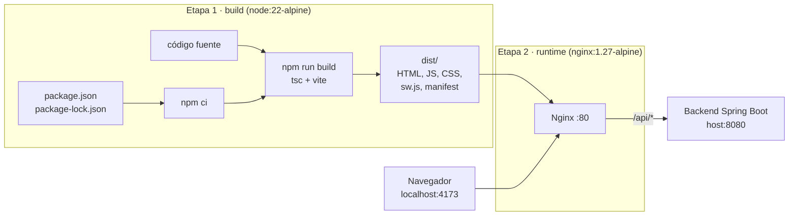

# Contenedor Docker de la PWA

> Guion de la exposición: [guion-presentacion.md](guion-presentacion.md)

La PWA de Vestigia se empaqueta en una imagen de Docker que **compila** el proyecto y lo **sirve con Nginx**. Con un solo comando cualquiera del equipo levanta la misma versión, sin instalar Node ni configurar nada en su equipo.

## Archivos

Todo lo de Docker vive en esta carpeta, `docker/`. El build usa como contexto la raíz del proyecto (ahí están `package.json`, `src/` y `public/`), por eso el `.dockerignore` se llama `Dockerfile.dockerignore`: Docker lo busca junto al Dockerfile.

| Archivo                                                      | Qué hace                                                                                |
| ------------------------------------------------------------ | --------------------------------------------------------------------------------------- |
| [`Dockerfile`](Dockerfile)                                   | Receta de la imagen, en dos etapas (build y runtime).                                   |
| [`Dockerfile.dockerignore`](Dockerfile.dockerignore)         | Lo que **no** se manda a Docker: `node_modules`, `dist`, `.git`, `.env`, documentación. |
| [`nginx/default.conf.template`](nginx/default.conf.template) | Configuración del servidor web dentro del contenedor.                                   |
| [`docker-compose.yml`](docker-compose.yml)                   | Levanta el contenedor con su puerto y variables en un solo comando.                     |

## Cómo funciona



1. **Etapa build:** parte de `node:22-alpine`, copia primero `package.json` y `package-lock.json` y ejecuta `npm ci`. Como esa capa solo cambia si cambian las dependencias, Docker la reutiliza de caché y los siguientes builds son mucho más rápidos. Después copia el código y ejecuta `npm run build` (TypeScript + Vite + `vite-plugin-pwa`), que genera `dist/` con el Service Worker y el manifest.
2. **Etapa runtime:** parte de `nginx:1.27-alpine` y copia **solo** `dist/`. La imagen final no lleva Node, `node_modules` ni código fuente: pesa unos **76 MB** (la etapa de build sola pesa 1.18 GB) y expone menos superficie.
3. **Nginx** (`default.conf.template`):
   - **SPA:** cualquier ruta (por ejemplo `/salas`) devuelve `index.html` y la resuelve React Router.
   - **PWA:** `sw.js`, `manifest.webmanifest` e `index.html` van con `Cache-Control: no-cache` para que el navegador detecte versiones nuevas; `/assets/*` (archivos con hash) se cachean un año.
   - **API:** todo lo que empieza con `/api/` se reenvía al backend (`API_UPSTREAM`). El navegador ve un solo origen, así que no hay problemas de CORS.
   - **gzip** para HTML, JS, CSS y JSON, y el tipo `application/manifest+json` para el manifest.
4. **Healthcheck:** cada 30 s Docker comprueba que Nginx responda; `docker ps` muestra `(healthy)`.

### Variables

| Variable                   | Cuándo se usa             | Valor por defecto                  | Para qué                                                                                     |
| -------------------------- | ------------------------- | ---------------------------------- | -------------------------------------------------------------------------------------------- |
| `VITE_API_URL` (build arg) | Al construir la imagen    | vacío                              | URL del backend incrustada en el JS. Vacío = mismo origen (Nginx reenvía `/api`).            |
| `API_UPSTREAM` (env)       | Al arrancar el contenedor | `http://host.docker.internal:8080` | A dónde reenvía Nginx `/api`. `host.docker.internal` es tu equipo visto desde el contenedor. |

## Comandos

Requisito: Docker Desktop abierto. **Los comandos se ejecutan dentro de esta carpeta** (`cd docker`). Desde la raíz del proyecto, agrega `-f docker/docker-compose.yml` después de `docker compose`.

```bash
# Construir la imagen y levantar el contenedor en segundo plano
docker compose up -d --build

# Ver que está corriendo (debe decir "healthy")
docker compose ps

# Ver los registros de Nginx (peticiones y errores)
docker compose logs -f pwa

# Detener y borrar el contenedor (la imagen se conserva)
docker compose down
```

Abre **http://localhost:4173**. Se usa el puerto 4173 porque el backend ya lo permite en CORS.

Sin Compose, lo equivalente es (desde la raíz del proyecto):

```bash
docker build -f docker/Dockerfile -t vestigia-pwa:latest .
docker run -d --name vestigia-pwa -p 4173:80 \
  -e API_UPSTREAM=http://host.docker.internal:8080 \
  --add-host host.docker.internal:host-gateway \
  vestigia-pwa:latest
```

Otros útiles: `docker images vestigia-pwa` (tamaño de la imagen), `docker history vestigia-pwa` (capas), `docker exec -it vestigia-pwa sh` (entrar al contenedor) y `docker inspect --format '{{.State.Health.Status}}' vestigia-pwa`.

### Con el backend

Para que `/salas` cargue datos, el backend de Spring Boot debe estar corriendo en tu equipo en el puerto 8080 (ver `backend/vestigia/docs/README.md` del monorepo). Sin backend, la página principal funciona igual y `/salas` muestra el estado de error con "Reintentar".

### Problemas comunes

| Síntoma                                                                 | Causa y solución                                                                                                                                                                  |
| ----------------------------------------------------------------------- | --------------------------------------------------------------------------------------------------------------------------------------------------------------------------------- |
| `port is already allocated`                                             | Ya hay algo en el 4173 (por ejemplo `npm run preview`). Ciérralo o cambia `'4173:80'` en `docker-compose.yml`.                                                                    |
| `/salas` muestra error y en los logs aparece `502` / `connect() failed` | El backend no está corriendo o no está en el 8080.                                                                                                                                |
| No se ven los cambios después de editar el código                       | Hay que reconstruir: `docker compose up -d --build`. Si el navegador sigue mostrando la versión anterior, recarga dos veces (el Service Worker se actualiza en la segunda carga). |

## Evidencias para la práctica

1. `docker compose up -d --build` terminando con `Image vestigia-pwa:latest Built` y `Container vestigia-pwa Started`.
2. `docker compose ps` con el estado `(healthy)` y el puerto `4173->80`.
3. `docker images vestigia-pwa` mostrando el tamaño (~76 MB).
4. Docker Desktop → **Containers** con `vestigia-pwa` en verde.
5. El navegador en `http://localhost:4173`: la página principal y `/salas` con datos.
6. DevTools → **Application**: Service Worker activo y manifest servido desde el contenedor.
7. `docker compose logs pwa` mostrando las peticiones `GET /api/salas` que reenvía Nginx.
